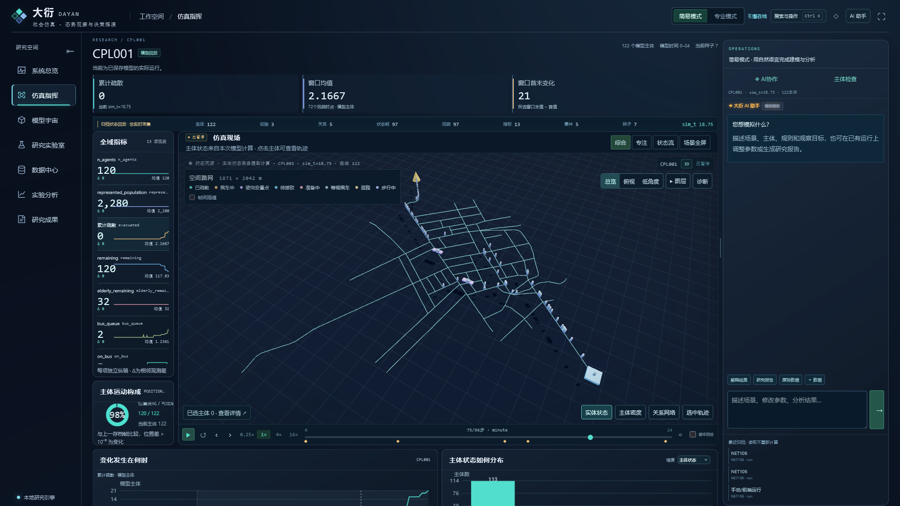

# DAYAN Future OS 视觉与交互验收

升级基线为 VNext `4730a3e`。本轮将「研究分析台」作为界面方向，保留既有实验、模型合同、研究数据、报告和 DSH 原生会话。三维、图表、模型关系和总览证据链直接读取同一服务的已存档数据。 [VNext 基线](VNEXT_ACCEPTANCE.md)

## 四轮实际视觉审查

1. 审阅 VNext 的九张截图及约 17 秒录屏。确认路网缩在视口中心，镜头聚焦有跳变，默认文件控件显示英文。总览、模型、分析和成果沿用相近的面板堆叠，重点内容难以区分。
2. 统一导航、字体、空间材质和状态颜色。在两种分辨率下检查同一 CPL001 归档，扩大真实路网投影。总览、模型关系和分析均有各自的主视觉。
3. 实测场景拾取、图层切换、镜头跟随、画布拖选、图例切换、可访问上传、研究阶段和报告。接入源坐标预览、独立留出图和版本导航。
4. 在浏览器逐页重拍。修复了首个档案可能停在 1 × 1 画布、窄分栏指标挤压场景、环路背景出现无数据依据的灯光、准备阶段沿用英文状态、年份轴出现小数以及规划器徽标误报。重新检查画布实际尺寸、WebGL 内容、全屏、标签、控件和滚动区域。 [四轮截图摘录](verification/future-os/visual-rounds.jpg) · [实际布局检查](verification/future-os/layout.json)

## 视觉与交互体系

深空蓝和石墨底色提供层级。青色用于运行与输入，紫色用于比较与证据，琥珀色用于干预和独立测试，红色用于实际异常或验证失败。标题、控制区和表格使用共享文字层级，观测量与标识采用等宽数字，切页、打开弹层、缩放与焦点反馈使用短缓动。系统的减弱动效设置同步应用到视图过渡、镜头和帧间插值。

| 工作空间 | 改版后的主视图与操作 | 前后对照 |
| --- | --- | --- |
| 系统总览 | 以归档档案的「训练数据 → 模型 → 运行 → 留出验证」形成证据链。侧栏显示真实目录、队列和数据资产容量，资源区读取内存和任务采样。每个节点可打开对应工作空间。 | [前](verification/vnext/mission-1920.png) · [后](verification/future-os/mission-1920.png) |
| 仿真指挥 | 自动构图、三种机位、全屏和专注视图。现场图层、进度和时间轴来自运行存档，点击主体可打开同一 ID 的位置、状态、属性轨迹、登记关系、几何近邻和关联事件。 | [1920 前](verification/vnext/command-1920.png) · [1920 后](verification/future-os/command-1920.png) · [2560 前](verification/vnext/command-2560.png) · [2560 后](verification/future-os/command-2560.png) · [浏览器全屏](verification/future-os/immersive.png) |
| 模型宇宙 | 可平移、缩放和聚焦的机制关系图。连线来自真实机制交集或已声明输入输出，家族颜色和线宽显示分组和共享机制数量。模型合同与审查依据仍可直接查看。 | [前](verification/vnext/models.png) · [后](verification/future-os/models.png) |
| 数据中心 | 中文键盘上传、来源和上游版本、可搜索资产、字段质量、源坐标地图、原文件与实际运行绑定。默认隐藏带明确验收标记的数据。 | [前](verification/vnext/data.png) · [后](verification/future-os/data.png) |
| 研究实验室 | 六步研究流程、训练／验证／测试色带、实际 RMSE、阈值、残差、参数扫描，以及直接下载的归档报告。 | [前](verification/vnext/lab.png) · [后](verification/future-os/lab.png) |
| 实验分析 | 大图、拖选时间窗、图例筛选、观察时点明细、多图与回放联动。单图、双图、四图和可选专业多图保存到浏览器。提供同时间口径对照、分布、种子范围、相关性、敏感性与 CSV / SVG 导出。 | [前](verification/vnext/analytics.png) · [后](verification/future-os/analytics.png) |
| 研究成果 | 归档索引旁可直接查看观测、预测或证据链。上游规约、模型、输入版本和原始报告可跳转和下载。 | [前](verification/vnext/outputs.png) · [后](verification/future-os/outputs.png) |

[1920 仿真指挥左右对照](verification/future-os/before-after-command.jpg) · [窄分栏实测](verification/future-os/narrow.png)

## 场景和数据证据

- **CPL001** 的 49 个源道路要素转为归档中的 843 条分段。实际投入模型的是 36 个普查区人口源点及其 2,280 人权重，画面使用 120 个模型行人和 2 辆模型车辆。接驳站和安置点仍按规约标注为假设，当地行为校准尚未完成。 [上轮来源与限制](verification/vnext/cpl_current_core.json)
- 镜头依据归档的空间边界、路网顶点、设施与主体分布定位。点选和悬停共享渲染对象的真实 ID，距离用已记录坐标计算。环路通量使用模型保存的全路观测，网络和事件位置采用归档明示的关系、坐标或主体。无位置的干预仍可从时间轴定位。
- **AI 大厅** 的墙、出口和 37 个模型主体来自原归档。 **NET106** 配对分析关联了六份实际运行的观测。 **加拿大年度失业率研究** 延续 18 个训练、3 个验证、4 个独立测试点，测试 RMSE 为 `1.07855` 个百分点，事前阈值为 `1` 个百分点，独立留出未通过。成果预览及实际下载 DOCX 保留同一结论。 [大厅截图](verification/future-os/hall.png) · [加拿大完整证据](verification/vnext/canada_facts.json)
- **DSH 原生** 从隔离宿主发送消息并取得真实 NET106 工具回执。密度 `0.25` 的实际结果同步到大屏，专业模式改到 `0.38` 后生成另一份运行。实测拖动分栏约 `110 px`、刷新后绑定及草稿、下载 13 条原始 CSV 观测和同源复现 ZIP。会话截图裁去账号侧栏和先前轮次。 [执行中](verification/future-os/native-processing.png) · [完成与归档](verification/future-os/native-ai.png) · [可核验回执](verification/future-os/native.json)
- 独立网页的任务阶段在实跑中逐项比对了队列服务响应，并在刷新后核对原始请求和运行。端内状态以服务回执为准。 [队列记录](verification/future-os/queue.json)

## 连续操作录屏

实际浏览器连续录制 `83.16 秒`，使用 1920 × 1080、25 fps 的 H.264 文件。依次查看加载、命令面板、模型机制图、CPL001 路网、摄像机与播放、主体检查、密度图层、专注模式、配对实验拖选、明细和加拿大研究归档。原生浏览器全屏另有独立截图。 [操作录屏 MP4](verification/future-os/workbench-recording.mp4) · [操作摘帧](verification/future-os/recording-frames.jpg) · [实际时间点](verification/future-os/recording.json)

## 性能与回归

相同电脑、Firefox 和保存归档的完整测量在 `performance.json`。加载采用先返回校验后的真实状态帧，再在原场景接入完整归档；准确回放在全量帧齐备后开放。视口采样上限为 3,000，档案保留全部 4,000 主体与 85 帧。读取时间从发起 API 请求开始，首画条件包含真实 WebGL 画布尺寸和绘制。帧率、GPU 提交后等待完成的总用时和进程 RSS 对应本次环境。 [性能原始记录](verification/future-os/performance.json)

| 同机配对指标 | VNext `4730a3e` | Future OS |
| --- | ---: | ---: |
| 初次可操作 | 965.9 ms | 855.3 ms |
| 切换到模型宇宙并出现目录 | 221.2 ms | 141.6 ms |
| CPL001 路网投影占场景宽度，1920 | 20.3% | 65.2% |
| CPL001 路网投影占场景宽度，2560 | 13.6% | 60.0% |
| 两种尺寸的路网投影高度占比 | 52.1% | 73.7% |
| 4,000 主体档案首画 | 8.13 s，85 帧齐全 | 0.93 s，先显示 5 帧 |
| 4,000 主体档案全量可用 | 8.14 s | 3.90 s |
| CPL001 / 4,000 主体回放 | 66.0 / 71.2 fps | 72.8 / 81.0 fps |
| 4,000 主体回放帧间隔第 95 百分位 | 30.02 ms | 20.02 ms |
| WebGL 绘制并等待完成，中位数 | 6 ms | 5 ms |
| 大归档载入后的浏览器进程 RSS | 732 MiB | 957 MiB |

两种尺寸的 843 段均无裁切。新版连续循环回放约 121 秒，WebGL 上下文未丢失，几何体和纹理计数维持 27 与 11。浏览器进程 RSS 在加载与首次循环的采样峰值约 1,041 MiB，末次采样约 481 MiB。采样窗口内两版大场景都未出现大于 50 ms 的帧间隔，暂停 1 秒的新增绘制均为零。

| 验收 | 证据 |
| --- | --- |
| 源码解析 | `python tests/check_sources.py`，228 个 Python 与 17 个 JavaScript 文件解析通过。 |
| 本地完整离线回归 | `python tests/run_all.py`，517 项通过，3 项按离线模式跳过，零失败。 [测试汇总](verification/future-os/offline.json) |
| 实际 Firefox | `python tests/browser_acceptance.py --base-url http://127.0.0.1:8933 --browser firefox --output .claude/browser-ci`，42 项通过。 [浏览器核验](verification/future-os/browser.json) |
| DSH 原生 | 13 项通过，包含真实执行、窄分栏、专业编辑、刷新和导出。 [原生核验](verification/future-os/native.json) |
| 数据与科学留存 | 核对了原有的 557 份用户数据文件，SHA-256 全部相同。原 VNext 证据目录与模型执行代码无差异。 [完整性结果](verification/future-os/integrity.json) |
| Windows、Linux 和 Chromium | 同一离线工作流。 [当前分支 Actions 记录](https://github.com/TZUKWAN/dayan-simulation/actions/workflows/offline.yml?query=branch%3Afeat%2Fdayan-future-os) |

Git 分支为 `feat/dayan-future-os`，以 `feat/dayan-vnext` 为 PR 目标。Python 执行源码指纹 `4ac7cdb7f3904bed2fe24f13094da1dfa04fe127b6120454aad5152fa2218767` 对应同一套机制审查。新归档的整包版本独立保存。图形沿用项目本地 Three.js、SVG、Canvas 和 CSS，可在本机离线加载。
