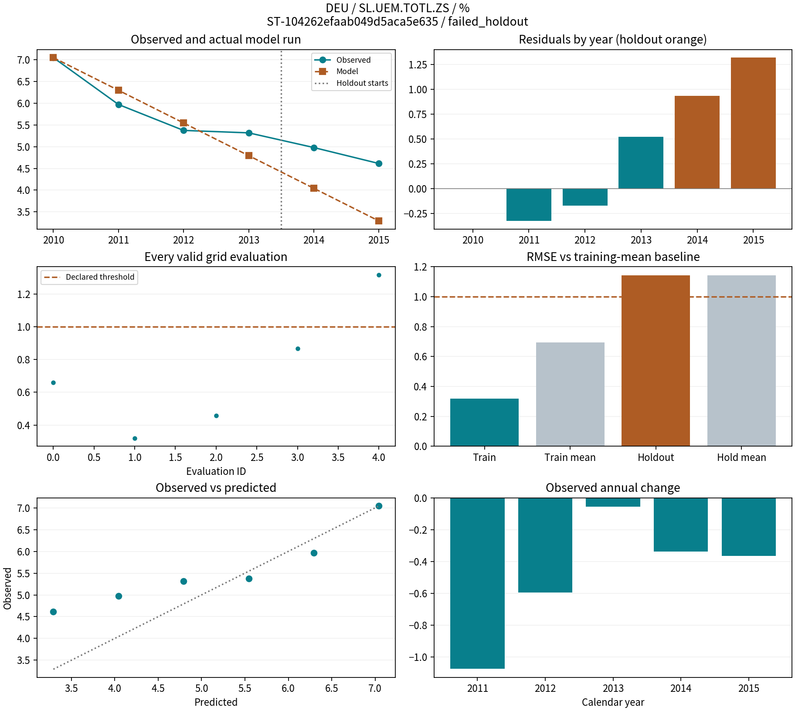
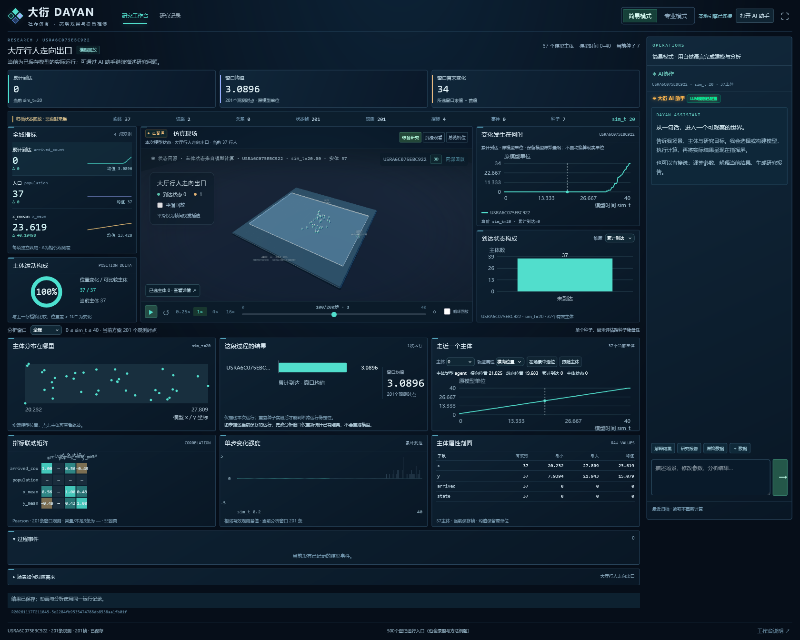
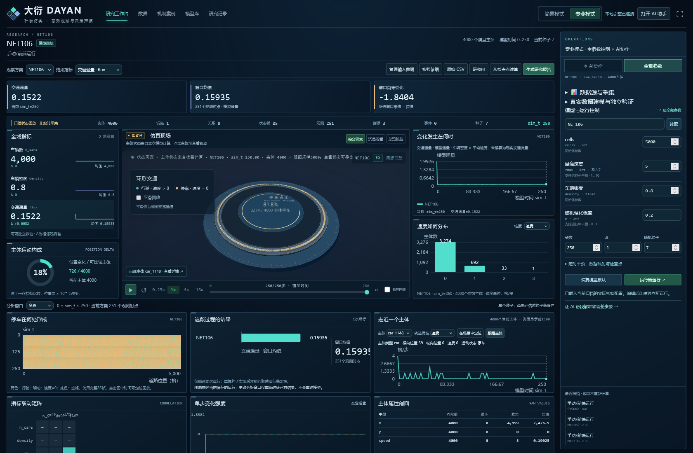

# DAYAN 系统审计与整改交付（2026-11-18）

本轮以 `07ca96d13de4bc842a5a5deb7aeaf6602c821939` 为基线，在 `fix/system-audit-20261118` 修复任务书中的运行可信性、研究任务、数据、归档、界面和部署问题。变更提交于 [PR #1](https://github.com/TZUKWAN/dayan-simulation/pull/1)，没有合并或覆盖 main，也没有操作用户正在使用的桌面窗口。

**已验证的是支持范围内的实际执行链路。模型运行成功、动画漂亮、真实数据存在、校准成功和现实预测有效是不同结论。** 德国失业率案例真实完成了采集、建模、校准和报告，但独立留出验证失败，系统如实保留了失败。

## 验收证据与版本

最终 Python 执行源码的规范化指纹为：

`e9b7223c7090128b9180c4f81c41219565bb8771b2dbb48cbd42daf812fe70c4`

身份计算仅统一文本检出的 CRLF/LF；运行归档另外保存每个文件的原始字节及 SHA-256。模型、引擎、运行时、研究编译器、旧版执行包、依赖和核心登记/语义文件均进入身份计算。证据不匹配时失效，不能沿用为当前证明。

| 验收项 | 实际结果 | 证据 |
|---|---|---|
| Windows、Linux 完整离线 CI | 每平台 83 套：508 个断言通过，3 项明确未执行，0 套失败；含 Python/Node、语法、依赖及源码清洁检查 | [CI 记录](verification/20261118/ci_offline.json)、[PR 当前 Checks](https://github.com/TZUKWAN/dayan-simulation/pull/1/checks) |
| 全部内置运行入口 | 497 项，491 项实际离线探针通过，6 项显式依赖外部服务，0 项探针失败 | [逐模型真实输出类型](../data/output_contract_evidence.json) |
| 目录消费最终证据 | 47 项目录、合同、Agent 与 SIR 路由断言通过 | [测试汇总](verification/20261118/tests.json) |
| 全新 Windows 检出与干净 venv | 13 个锁定核心/开发依赖已实际安装，pip check 通过；首次干净环境 16 项，最终换行/静态/合同增量 39 项通过，跟踪文件无污染 | [干净检出记录](verification/20261118/clean_checkout.json) |
| 六类代表性研究 | 24 次实际归档运行，六个基线/对照实验，每臂两个配对种子 | [规约、输出、效应与哈希](verification/20261118/representative_scenarios.json) |
| 网页 AI 生成新模型 | 真实生成与独立语义审核调用、实际运行、37 个行人、原始描述、坐标、速度、出口与末帧核对通过 | [完整定义与调用回执](verification/20261118/web_model.json) |
| 五类生成式主体 | BEH129–133 各两次真实 LLM 决策、两步实际环境反馈，合计 10 次调用；行动数与事件逐项对应 | [真实行动记录](verification/20261118/live_cognitive.json) |
| DSH 原生研究与界面 | 安装版 0.2.2-rc.1 的 7 次真实工具调用、原始研究问题及产物核对；9 项原生界面检查通过 | [原生研究](verification/20261118/native_research.json)、[原生界面](verification/20261118/native_ui.json) |
| 工作台与 3D | 独立隐藏浏览器核对真实 WebGL、主体 ID/位置、回放、暂停、事件、简易/专业模式、采样、恢复和转义；截图来自实际运行 | [浏览器回执与完成 GPU 计时](verification/20261118/browser.json) |
| 原有研究数据保全 | 原有 557 个文件逐一核对 SHA-256，0 个改变、0 个缺失 | [数据保全](verification/20261118/data_preservation.json) |

离线统计中的三项未执行分别为：未选择的在线数据套件、未选择的真实 LLM 套件、引擎套件内未选择的本地 LM Studio 玩家检查。它们没有算作通过。真实网络与付费模型验收另行执行并单列，不用离线 fixture 冒充。

## 问题、原因和处理结果

下表每项都有对应源码修改及定向回归；其后又通过统一入口或实际应用链路核验。完整提交历史保留在修复分支。

| 优先级 | 位置与问题 | 原因及修复 |
|---|---|---|
| P0 | `output_contract.py`、`agent/metadata.py`、`research/compiler.py`：观测字段缺失，SIR/NET052 无法检索或编译 | 统一源码声明、静态提取与版本锚定的真实探针输出类型。未知字段仍未知；不通过臆测指标或“取第一个数值”执行研究。NET053 的 beta/gamma 与 S/I/R 联合检索通过。 |
| P0 | NET052 原始自然语言实验无法执行 | 完整保留 beta=.4、40 步、dt=.1、种子 7/8、t=2 时 beta=.2；真正执行四次配对运行，干预前轨迹一致、干预时间与记录一致。 |
| P0 | `models/beh_abm.py:EpsteinViolenceModel`：警察原地不动及警民机制不一致 | 修复实际警察位置、周期空间视野、G=H(1-L)、风险 C/A、逮捕、刑期与释放。保留三阶段调度等简化，完整快照含随机状态；五项机制测试通过。 |
| P0 | `engines/games.py`：非遮蔽异常、玩家方位与随机回退 | 名称、行动语义和收益方向按玩家方位构造；解析失败使用调用者随机流，不再重置固定种子。非对称 2×2 内部混合均衡 p=.8、q=.25 的数值无差异条件通过。 |
| P0 | `server.py`、`access.py`：任意来源、无统一鉴权、本地文件风险 | 精确 Host/Origin、同源 HttpOnly/SameSite cookie、DSH 本机 Bearer 能力文件，保护 API 和报告。令牌不进入 URL/HTML。路径先校验再访问文件系统，非法分隔符/NUL/目录穿越返回拒绝。 |
| P0 | `task_manager.py`、`task_worker.py`、`limits.py`：请求直接开线程、缺少统一预算 | 改为有界持久队列和受监督子进程，控制并发、排队、CPU/RSS/墙钟/磁盘、总步数、实验臂/种子、请求体及状态帧。可取消，重启能识别中断任务，不自动重放付费工作。 |
| P0 | 进程隔离后网站 AI planner 未注入 | 宿主与工作进程使用同一个 `configure_planner`，避免真实建模悄悄降成只有规则执行。明确的新模型请求由规则准确路由后，仍调用真实生成与审核模型。 |
| P0 | `tests/run_all.py`：固定清单漏测、退出/跳过统计失真、依赖历史状态 | 动态发现全部 Python/Node 入口，按七类分组，隔离源码/数据/报告，真实保留退出码、失败、skip、空跑及超时；失败输出保留定位信息。在线失败不再一律包装成 skip。 |
| P1 | `fidelity.py`、`source_version.py`：历史审查冒充当前、目录首屏跑探针 | 首屏只组装元数据，实测约 1.456 秒，不运行全库。历史证据失效保留原件；只给实际复核的 8 项建立当前源码锚点。规范化检出换行，精确归档另保留原始文件字节。 |
| P1 | `research/requirements.py`、`compiler.py`、`semantics.py`：研究问题被替换 | 增加 29 项有源码依据的模型语义、19 类机制；比较候选、区分 SIR/SEIR/SIS、保留否定、多轮配置、主体、地区、时间、种子、分析窗口及明确参数。缺口具体报出，不默认换成 SIS 或插入 1.2 倍干预。 |
| P1 | 真实网页验收：出口 x/y 被当作行人属性同名参数 | 将有明确所属设施的坐标规范为 exit_x/exit_y、target_x/target_y 或 start_x/start_y，普通方程参数 x/y 仍保留；用原始中文句子重试真实生成成功。 |
| P1 | `scene_contract.py`、`agent/model_tools.py`：模型与场景对应不稳 | 数量、角色、空间、设施和行为必须引用实际定义与数据流；设施不能靠装饰冒充作用。独立真实模型复核语义；提供可用字段路径，只修复格式错误的回执，正常语义拒绝不重试成批准。 |
| P1 | `coupled.py`、`agent/composer.py`：不同时间终点、隐式量纲映射 | 使用共同实际终点和末尾短步，明确输入/输出端口、单位与主体范围、顺序初始化或反馈时序。禁止任意首指标拼接，先检查整体预算；参考模式、端口轨迹和完整检查点恢复通过。 |
| P1 | `models/eco_final.py`：Goodwin 时间暗乘 3、输出裁剪 | 移除隐式变速和裁剪，数值细分不改变仿真时长；目录与独立核心、第一积分数值检查通过。明确经典正轨道并不对任意初态保证经济比例小于 1。 |
| P1 | `models/traffic.py`：车辆密度暗中改变随机刹车率 | 密度与 p 独立，p=None 兼容入口采用固定默认 .2；构造与初始化保持一致。真实轨迹、nullable 参数接口和车辆数量定向测试通过。 |
| P1 | `models/wave2.py`：低传播率 SIS 理论均衡为负，beta=0 可除零 | 按物理均衡分支显示 R0≤1 时 I*=0，beta=0 保持有限；实际感染量按原方程衰减，不改轨迹来制造“成功”。 |
| P1 | 若干博弈/经济模型：初始空历史产生 NaN、参数未使用、错误理论均值 | 未定义统计改为 null 并提供样本数，不以假零或 epsilon 填充；Santa Fe 三组交易者规模真正参与需求；Kirman 对称招募均值修正为 .5，并验证镜像随机轨迹。 |
| P1 | `datasets.py`、`collection/transport.py`：数据口径与传输证据不足 | 校验单位、频率、空间/主体范围、筛选、顺序及转换；训练与留出分离。HTTPS 固定已验证公网 IP，保留原域名 TLS 验证，代理 CONNECT/重定向复检、压缩和大小上限仍有效。 |
| P1 | `run_store.py`、`reproducibility.py`、`replay.py`：代码和环境归档不全 | 归档执行包、引擎、配置样板、依赖、工作台/插件、字体及逐文件哈希，记录实际环境/预算。旧加载代码与磁盘或排队源版本不一致时拒绝冒名；可验证包并用其中真实源码另进程重跑。 |
| P1 | `llm_limits.py`、新旧 LLM 调用方：固定小输出上限、历史截断 | 从真实元数据/官方具体模型资料解析上下文与输出能力，保留完整输入历史。实际配置的服务接受 393216 最大输出参数，上下文 1000000；这是上限接受证据，未冒称生成过 393216 token。 |
| P1 | Windows 状态文件瞬时共享冲突及异常进程残留 | 对实际出现的状态读/原子替换共享冲突作有界重试；异常取消自己拥有的工作子进程、等待退出。21 项相关回归及后续完整 CI 通过。 |
| P2 | `server.py`：启动改写源 HTML、WebP MIME 错误 | 缓存版本只在响应中转换，启动不写源文件；WebP 返回 image/webp，本地第三方脚本返回正确 JS 类型；只读源文件启动测试通过。 |
| P2 | `site/console/`：重复执行/报告分支、补丁和静态资源残留 | 清除不再调用的旧执行、默认干预和报告路径，沿用单一结果控制器；去除重复补丁和同字节图片，保持简易/专业模式及原生 DSH 使用方式。 |
| P2 | `results.js`：晚到的默认恢复覆盖用户编辑 | 手动意图取消自动恢复；异步视图版本防止旧响应覆盖新选择。参数、当前运行与未发送草稿保持一致。 |
| P2 | `sys_models.py`、`beh_abm.py`：队列位置或格点被当作主体身份 | 队列顾客和服务分配持久化；Schelling 居民 ID 随搬迁移动、类型/数量不变。视图不再用队列序号或格点冒充“同一个人”。 |
| P2 | `runtime.py`、`run_store.py`：大场景末观测 250、末帧 249 | 强制保留真实最终状态；包括非整除采样、恢复与干预，主体帧和观测共用时钟，不为画面重新跑模型。 |
| P2 | `analysis.js`、`results.js`：事件重复、常量序列假相关 | 同一实际干预在清单与事件镜像中去重，不合并不同真实事件；稳定协方差使常量序列相关系数保持未定义，拒绝把浮点噪声画成 1。 |
| P2 | `viz3d.js`、`scene-studio.js`：外网 CDN、海量逐体绘制、暂停仍重绘 | 分发经上游完整性验证的本地 Three.js；密集交通使用共享实例和适合格点尺度的几何体，ID/坐标/颜色/选择保留。视图按稳定 ID 优先级采样而非取空间排序前缀；停止暂停图表重绘，汇总动画继续明确标注示意。 |
| P2 | `fonts.py`、`report_gen.py`、`research_charts.py`：中文缺字 | 随包提供官方 Noto Sans CJK SC 原件与 OFL 许可证，注册字体并检验字形；中文/负号绘图和实际报告通过。DOCX 存储 Unicode 并指定字体，阅读设备仍需该字体或中文回退字体。 |
| P2 | `.github/workflows/offline.yml`、`.gitattributes`：无 CI、远端检出才出现字节变化 | 加入 Windows/Linux 离线与实际浏览器任务；修复 job 环境变量作用域、NUL 路径和 Windows 第三方库换行变换。字体及 vendor 保留原始字节，CI 不上传大型研究产物。 |

## 当前模型目录口径

来自 [实际目录统计](verification/20261118/catalogue.json)：

- 静态登记 557：模型 483、应用 22、软件引用 52；合并目录 561。
- 内置运行入口 497，其中 493 项有静态登记，4 项为兼容/基准入口：MET-DTMC、MET-MM1、NET-SIR、NET064_jump。
- 64 项没有运行工厂，其中 52 项是软件引用，12 项为尚无工厂的模型/应用。它们没有被伪标为已实现。
- 当前离线探针通过 491，明确外部依赖 6。探针只验证默认参数小步实际运行及有限输出。
- 当前机制审查锚定 8 项：full 5、lite 3；另有 prototype 425、method_demo 64、registered 64。486 条未锚定当前源码的历史审查继续保留为历史。
- full 只表示所列核心机制，不能当作现实数据校准或政策预测有效。逐模型简化与证据见 [当前审查](../data/fidelity_review/zzz_verified_20261118.json)。

这不是把所有模型重新审定为科学有效。SIS/SIR 理论依据见 [Hethcote](https://doi.org/10.1137/S0036144500371907)，NaSch 规则见 [原始论文](https://doi.org/10.1051/jp1:1992277)，居住分异的建模依据见 [Schelling](https://doi.org/10.1080/0022250X.1971.9989794)。实现中的具体近似、参数与测试范围另行披露。

## 六类研究与真实数据链路

[可重跑验收驱动](verification/20261118/run_scenarios.py) 使用现有 ExperimentSpec / RunManifest，不建立第二套仿真或手写结果。运行时必须指定新的私有输出目录：

```powershell
python docs/verification/20261118/run_scenarios.py --output .claude/representative-verification
```

| 场景 | 实际模型与对照 | 核对内容 |
|---|---|---|
| 疫情 | NET052：t=2 将 beta=.4 减为 .2 | 两种子各两臂，干预前相同，后续实际感染量降低，时点与规约一致 |
| 交通疏散 | NET113：37 人，期望速度 .8 与 1.6 | 实际位置、人数守恒、出口与疏散观测；假设房间，不冒充真实城市 |
| 排队资源 | SYS002：M/M/2，服务率 1 与 1.5 | 实际等待、顾客身份、服务台、参数与末帧 |
| 网络传播 | NET063：逐边感染率 .3 与 .1 | 实际随机跳跃、S+I+R=100；固定合成邻接表，不冒充采集的社交网络 |
| 经济动力学 | ECO019：相同显式初态，折旧 .03 与 .05 | 实际工资份额/就业轨迹、经过时长、第一积分与未裁剪状态 |
| 多主体 | BEH001：相似度阈值 .4 与 .7 | 居民持久身份、类型、位置、数量和有限时长实际隔离指标；不预设效应方向 |

这些是模型内反事实实验，不是现实因果识别。`window_mean` 是所记录观测的算术均值；跳跃过程的事件样本均值不是按持续时间加权的时间平均。没有把两个随机种子当作现实被试样本或显著性证明。

真实 World Bank 案例使用 DEU、SL.UEM.TOTL.ZS、2010–2015 共六年。2010–2013 用于训练，2014–2015 留出；训练数据文件明确排除了留出年份。原始响应、解析结果、训练集、模型绑定、参数网格与实际运行均有哈希和 ID。原生 AI 起初提交冲突日期时被拒绝，随后实际纠正并采集；原始严格驱动的失败记录没有被改写为绿色，另由逐工具回执与实际产物复核确认恢复成功。

训练 RMSE **0.3197835205259959**，留出 RMSE **1.14364701722166**，事前阈值 **1.0 个百分点**，结论 **failed_holdout**。线性模型下降过快；报告、界面和原生回答都没有把它说成验证通过。数据版本与六个实际值见 [来源及校准记录](verification/20261118/native_research.json)。



## 场景与原生交互的实际结果

网页真实建模原句要求：37 名行人、40×30 米大厅、左侧指定区域初始化、固定 1 米/秒、右侧出口 (40,15)、到达停止、200 步、dt=.2、种子 7。最终实际模型保留原文，两个真实模型调用完成定义生成与独立语义审核；程序另核对全部 37 个 ID、初始坐标、路程及最终时刻。没有用预制的无关 SIS/随机游走替代。



大场景保存 4000 个真实车辆主体、251 个观测和 85 个状态帧；显示采样 3000 个主体并明确标注，全量状态仍可导出。最终实例化渲染为 27 个几何资源、36 次绘制调用；性能数据包含 `WebGL finish`，不只测异步提交时间。具体本机计时见 [浏览器回执](verification/20261118/browser.json)，不把单机结果推定为所有硬件的帧率。



DSH 真实验收在独立隐藏宿主和隔离数据目录完成：原生对话与嵌入工作台使用同一保留会话，读取同一个 study/run，未出现第二个嵌入 AI 聊天；拖拽宽度实际改变 120 像素，并保留会话和未发送草稿。没有为验证而刷新用户正在工作的桌面应用。

## 部署、复核结论与边界

安装、访问能力、DSH、资源预算、在线测试、字体及归档重跑说明见 [DEPLOYMENT.md](DEPLOYMENT.md)。本轮修复仍在独立分支；要运行该版本须检出该分支并重新启动相应后端/重新加载插件。用户当前主分支和桌面宿主没有自动切换；不能把隔离宿主验收说成用户现有窗口已刷新。

主模型复核了原始任务、实际源码与提交、测试日志、真实来源哈希、研究规约/数据绑定、训练留出、报告事实、生成模型表达式、原生工具回执和实际截图。源码修复的失败用对应回归确认；最终证据的指纹及 Git 检出字节另行核对。原有研究数据和私人配置没有作为公开仓库内容提交。

仍须准确理解以下能力边界：

1. 425 个 prototype 与 486 条历史审查不是全量当前科学审定；64 项无工厂没有被本轮伪造实现。新增研究应依据当前能力合同及逐研究证据选择。
2. 已实调五种生成式主体的小型适配，不代表复现原论文完整环境与评测。CPL001 的耦合/空间数据合同有机械验证，本轮没有完成它在真实地区路网和人口上的实证校准；离线入口始终披露其外部输入依赖。
3. 实际来源本轮重点验收 World Bank，不能推出每个注册渠道现在都可访问。需要账号、密钥或不可获得的公开数据仍须具体标明，不能替换国家、地区、年份或数据定义。
4. 德国线性趋势留出失败，不能用于已验证的现实政策预测；网格内最优也不证明结构参数可识别。
5. 未实现的多层/刚体碰撞/烟气等机制会具体拒绝，不能靠装饰动画冒充。大场景视图采样、格点尺度、插值与汇总示意仍须按界面标注解读。

后续开发应优先围绕具体研究问题，补对应模型的原文复核、单位与数据映射、独立留出与敏感性/不确定性实验，再提高适用状态；不以模型总数或通过的测试数替代研究有效性。
